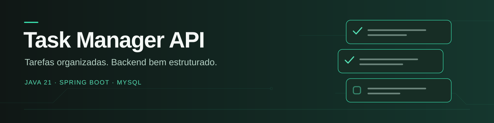
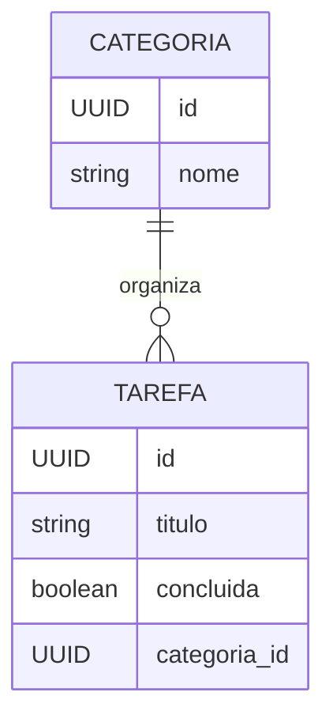

# Task Manager API

API REST para gerenciamento de categorias e tarefas, desenvolvida com Java, Spring Boot e Spring Data JPA. Inclui validação de entrada, paginação, migrações Flyway, documentação interativa OpenAPI/Swagger UI e pipeline de CI com testes, JaCoCo e SonarCloud.

[](https://github.com/Vitor-C-Souza/task-manager/actions/workflows/ci.yml)


> Documentação da branch `development`. API backend sem interface gráfica ou autenticação implementadas nesta base; os cartões do banner são uma ilustração.

## Sumário
- [Funcionalidades](#funcionalidades)
- [Tecnologias](#tecnologias)
- [Arquitetura](#arquitetura)
- [Pré-requisitos](#pré-requisitos)
- [Configuração e execução](#configuração-e-execução)
- [Documentação da API](#documentação-da-api)
- [Endpoints](#endpoints)
- [Paginação](#paginação)
- [Validação e erros](#validação-e-erros)
- [Banco de dados](#banco-de-dados)
- [Testes e cobertura](#testes-e-cobertura)
- [Integração contínua](#integração-contínua)
- [Boas práticas e segurança](#boas-práticas-e-segurança)
- [Licença](#licença)

## Funcionalidades
- CRUD de categorias e tarefas.
- Associação de cada tarefa a uma categoria existente.
- Alternância do status de conclusão de uma tarefa via `PATCH`.
- Listagens paginadas.
- Validação de entradas com Jakarta Bean Validation.
- Tratamento global e padronizado de exceções.
- Documentação OpenAPI e interface Swagger UI.
- Migrações versionadas do banco de dados com Flyway.

## Tecnologias
| Tecnologia | Uso |
| --- | --- |
| Java 21 | Linguagem e plataforma |
| Spring Boot 4.1.1 | Inicialização e configuração |
| Spring Web MVC | Endpoints REST |
| Spring Data JPA / Hibernate | Persistência relacional |
| MySQL | Banco de dados local |
| H2 | Banco de dados de testes |
| Flyway | Migrações de esquema |
| Jakarta Bean Validation | Validação de dados |
| springdoc-openapi 3.1.1 | Especificação OpenAPI e Swagger UI |
| JUnit / Spring Boot Test | Testes automatizados |
| JaCoCo | Cobertura de testes |
| SonarCloud | Análise de qualidade e dependências |
| Maven Wrapper | Build reproduzível |
| Docker Compose | Inicialização local do MySQL |

## Arquitetura
O código está organizado por responsabilidade no pacote `com.vitorcsouza.app.task_manager`:

```text
src/main/java/com/vitorcsouza/app/task_manager/
├── config/             # Configuração OpenAPI
├── controller/         # Endpoints HTTP/REST
├── domain/
│   ├── dto/            # Contratos de entrada e saída
│   ├── model/          # Entidades JPA
│   ├── repository/     # Repositórios Spring Data
│   └── service/        # Interfaces e regras de negócio
├── infra/exception/    # Exceções e tratamento global
└── TaskManagerApplication.java

src/main/resources/
├── db/migration/       # Migrações Flyway
└── application-dev.properties
```

Fluxo simplificado: controller recebe e valida a requisição; serviço aplica regras de negócio; repositórios acessam o banco; DTOs definem os dados expostos pela API; o tratamento global converte exceções em respostas HTTP.

### Relação entre categorias e tarefas



### Regras de negócio

- Uma tarefa exige uma categoria existente e começa com `concluida=false`.
- O `PUT` de tarefa atualiza título e categoria; a conclusão é alterada pelo `PATCH`.
- O `PATCH` inverte o status a cada chamada; repeti-lo pode desfazer a alteração anterior.
- Excluir uma categoria com tarefas vinculadas retorna conflito de integridade (`409`).
- As operações de escrita usam transações; as consultas são marcadas como somente leitura.

## Pré-requisitos
- JDK 21.
- Git.
- Docker com Docker Compose, ou MySQL instalado localmente.
- Acesso à internet na primeira compilação para baixar dependências Maven.

## Configuração e execução
### 1. Clonar o repositório
```bash
git clone https://github.com/Vitor-C-Souza/task-manager.git
cd task-manager
git switch development
```
> Este guia descreve a branch `development`; confirme a branch desejada antes de executar comandos.

### 2. Iniciar o banco
O `docker-compose.yaml` inicia o MySQL na porta `3306` e cria o banco `db_task_manager`.
```bash
docker compose up -d mysql
docker compose ps
docker compose logs -f mysql
```
O Compose usa `root` como usuário e senha para facilitar o ambiente local. Essas credenciais são apenas para desenvolvimento; não as reutilize em produção ou ambientes compartilhados.

Aguarde o MySQL aceitar conexões antes de iniciar a aplicação: o Compose atual não define health check nem inicia a API. A imagem está configurada como `mysql:latest`, sem versão fixa.

### 3. Conferir a configuração
O perfil de desenvolvimento está em `src/main/resources/application-dev.properties`. Por padrão, espera MySQL em `localhost:3306`, banco `db_task_manager`, usuário `root` e senha `root`. Ajuste `spring.datasource.*` se sua configuração local for diferente. Não versione senhas reais.

### 4. Executar a aplicação
Linux/macOS:
```bash
chmod +x mvnw
SPRING_PROFILES_ACTIVE=dev ./mvnw spring-boot:run
```
Windows PowerShell:
```powershell
$env:SPRING_PROFILES_ACTIVE = "dev"
./mvnw.cmd spring-boot:run
```
A API fica disponível em `http://localhost:8080`, salvo configuração diferente. Na inicialização, Flyway aplica migrações pendentes e Hibernate valida o esquema.

Gerar o pacote:
```bash
./mvnw clean package
```
No Windows, use `./mvnw.cmd clean package`.

## Documentação da API
O projeto usa springdoc-openapi para gerar a especificação OpenAPI e servir Swagger UI. Com a aplicação em execução:
- **Swagger UI:** [http://localhost:8080/swagger-ui.html](http://localhost:8080/swagger-ui.html)
- **OpenAPI JSON:** [http://localhost:8080/v3/api-docs](http://localhost:8080/v3/api-docs)
- **OpenAPI YAML:** [http://localhost:8080/v3/api-docs.yaml](http://localhost:8080/v3/api-docs.yaml)

A interface permite consultar rotas, modelos de entrada/saída e experimentar chamadas pelo navegador.

## Endpoints
Todas as rotas de negócio usam o prefixo `/api/v1`; os identificadores são UUIDs.

### Categorias — `/api/v1/categoria`
| Método | Rota | Descrição | Sucesso |
| --- | --- | --- | --- |
| `POST` | `/api/v1/categoria` | Criar categoria | `201 Created` |
| `GET` | `/api/v1/categoria/{id}` | Buscar categoria por ID | `200 OK` |
| `GET` | `/api/v1/categoria` | Listar categorias paginadas | `200 OK` |
| `PUT` | `/api/v1/categoria/{id}` | Atualizar categoria | `200 OK` |
| `DELETE` | `/api/v1/categoria/{id}` | Excluir categoria | `204 No Content` |

Exemplo de criação:
```http
POST /api/v1/categoria
Content-Type: application/json
```
```json
{
  "nome": "Trabalho"
}
```

### Tarefas — `/api/v1/tarefa`
| Método | Rota | Descrição | Sucesso |
| --- | --- | --- | --- |
| `POST` | `/api/v1/tarefa` | Criar tarefa associada a categoria existente | `201 Created` |
| `GET` | `/api/v1/tarefa/{id}` | Buscar tarefa por ID | `200 OK` |
| `GET` | `/api/v1/tarefa` | Listar tarefas paginadas | `200 OK` |
| `PUT` | `/api/v1/tarefa/{id}` | Atualizar título e categoria | `200 OK` |
| `PATCH` | `/api/v1/tarefa/{id}` | Alternar status de conclusão | `200 OK` |
| `DELETE` | `/api/v1/tarefa/{id}` | Excluir tarefa | `204 No Content` |

Exemplo de criação (use o UUID de uma categoria existente):
```http
POST /api/v1/tarefa
Content-Type: application/json
```
```json
{
  "titulo": "Revisar documentação",
  "categoriaId": "00000000-0000-0000-0000-000000000000"
}
```
O endpoint `PATCH /api/v1/tarefa/{id}` não recebe corpo; ele inverte `concluida` entre `true` e `false`.

### Regras dos DTOs
- Categoria: `nome` é obrigatório e não pode estar em branco.
- Tarefa: `titulo` é obrigatório e não pode estar em branco; `categoriaId` é obrigatório e deve corresponder a uma categoria existente.
- Respostas incluem ID e timestamps `createdAt` e `updatedAt`; respostas de tarefa incluem um resumo da categoria.

### Fluxo rápido com cURL

Com a API em execução, crie uma categoria:

```bash
curl -i -X POST http://localhost:8080/api/v1/categoria \
  -H "Content-Type: application/json" \
  -d '{"nome":"Estudos"}'
```

Copie o `id` retornado e substitua `UUID_DA_CATEGORIA`:

```bash
curl -i -X POST http://localhost:8080/api/v1/tarefa \
  -H "Content-Type: application/json" \
  -d '{"titulo":"Estudar testes de API","categoriaId":"UUID_DA_CATEGORIA"}'
```

Use o `id` da tarefa criada para alternar a conclusão:

```bash
curl -i -X PATCH http://localhost:8080/api/v1/tarefa/UUID_DA_TAREFA
curl -i "http://localhost:8080/api/v1/tarefa?page=0&size=5&sort=titulo,asc"
```

Os exemplos usam sintaxe Bash. No PowerShell, utilize o Swagger UI ou adapte as aspas e use `curl.exe`.

## Paginação
Os endpoints de listagem aceitam parâmetros do Spring Data:
| Parâmetro | Padrão | Descrição |
| --- | --- | --- |
| `page` | `0` | Índice da página, começando em zero |
| `size` | `5` | Itens por página |
| `sort` | Configuração Spring Data | Campo e direção, por exemplo `sort=nome,asc` |

Exemplo: `GET /api/v1/tarefa?page=0&size=10`. A resposta inclui o conteúdo e metadados de paginação.

## Validação e erros
O tratamento global de exceções pode retornar:
| Status | Situação |
| --- | --- |
| `400 Bad Request` | DTO inválido, JSON malformado ou parâmetro com tipo inválido |
| `404 Not Found` | Categoria ou tarefa não encontrada |
| `409 Conflict` | Violação de integridade de dados |
| `405 Method Not Allowed` | Método HTTP não suportado |
| `500 Internal Server Error` | Erro inesperado |

As respostas de erro incluem instante, status, título, mensagem e caminho da requisição. Erros de validação também incluem os campos inválidos.

## Banco de dados
O Flyway gerencia o esquema em `src/main/resources/db/migration/`. A migração inicial `V1__CREATE_TABLES.sql` cria `tb_categoria` e `tb_tarefa`, com UUIDs binários, timestamps e chave estrangeira de tarefa para categoria.

Não edite migrações que já foram aplicadas em ambientes persistentes; crie uma nova migração versionada para alterações futuras.

## Testes e cobertura
Execute testes e validação de cobertura:
```bash
./mvnw clean verify
```
No Windows, use `./mvnw.cmd clean verify`.

A suíte inclui testes de serviços com mocks, testes MVC de controllers com MockMvc e teste de contexto. O perfil `test` usa H2 em modo MySQL com Flyway ativo; ele dispensa MySQL externo, mas não substitui testes contra o banco real. Se você ativou `dev` na sessão do terminal, desative-o antes de executar a suíte, para manter o ambiente de testes isolado.

O JaCoCo gera o relatório HTML em `target/site/jacoco/index.html` e o XML em `target/site/jacoco/jacoco.xml`, utilizado pelo SonarCloud. O build exige cobertura mínima de **80% das linhas**. DTOs e classes de `infra/exception` estão excluídos da cobertura no JaCoCo e no Sonar. A meta configurada não representa o percentual atualmente alcançado; consulte o relatório do build ou o [painel SonarCloud](https://sonarcloud.io/dashboard?id=Vitor-C-Souza_task-manager&branch=development).

## Integração contínua
O workflow `.github/workflows/ci.yml` roda em pushes e pull requests para `main` e `development`. Ele configura JDK 21, executa `./mvnw clean verify sonar:sonar`, gera e valida a cobertura e envia a análise ao SonarCloud. Em caso de falha, publica relatórios de teste e cobertura como artefatos.

Configure o segredo `SONAR_TOKEN` nas configurações do repositório GitHub. Nunca coloque tokens no código, no README ou em arquivos versionados.

## Boas práticas e segurança
- Não versione credenciais, tokens ou segredos.
- Use credenciais específicas e de privilégio mínimo fora do ambiente local.
- Mantenha validações de entrada e respostas de erro consistentes.
- Versione mudanças no esquema com novas migrações Flyway.
- Execute `./mvnw clean verify` antes de abrir pull requests.
- Atualize esta documentação quando rotas, contratos ou configuração mudarem.
- Revise dependências e alertas do SonarCloud periodicamente.

## Autor

**Vítor Cavalcante Souza** · [GitHub](https://github.com/Vitor-C-Souza) · [LinkedIn](https://www.linkedin.com/in/vitorcavalcantesouza/)

## Licença
Nenhum arquivo de licença foi identificado no repositório no momento desta documentação. Até que uma licença seja adicionada, não presuma que o código esteja liberado para reutilização, distribuição ou modificação.
